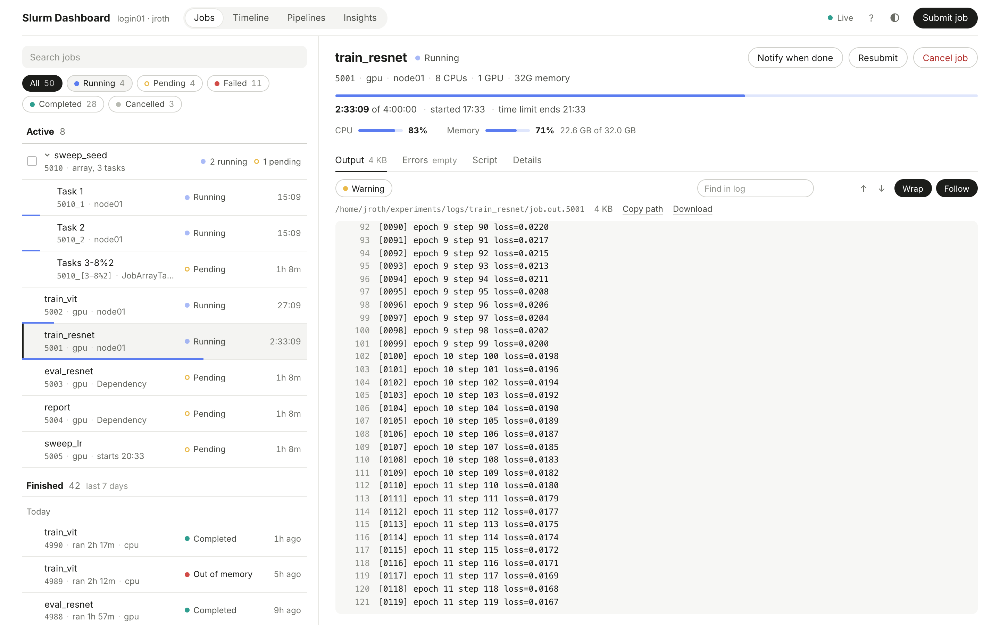
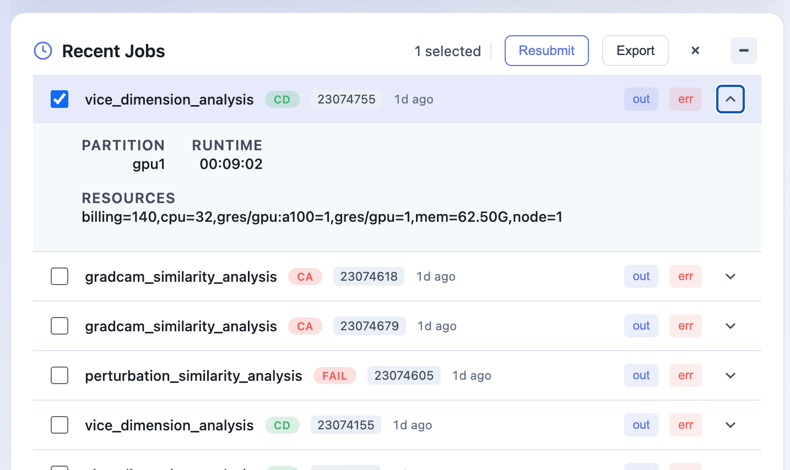
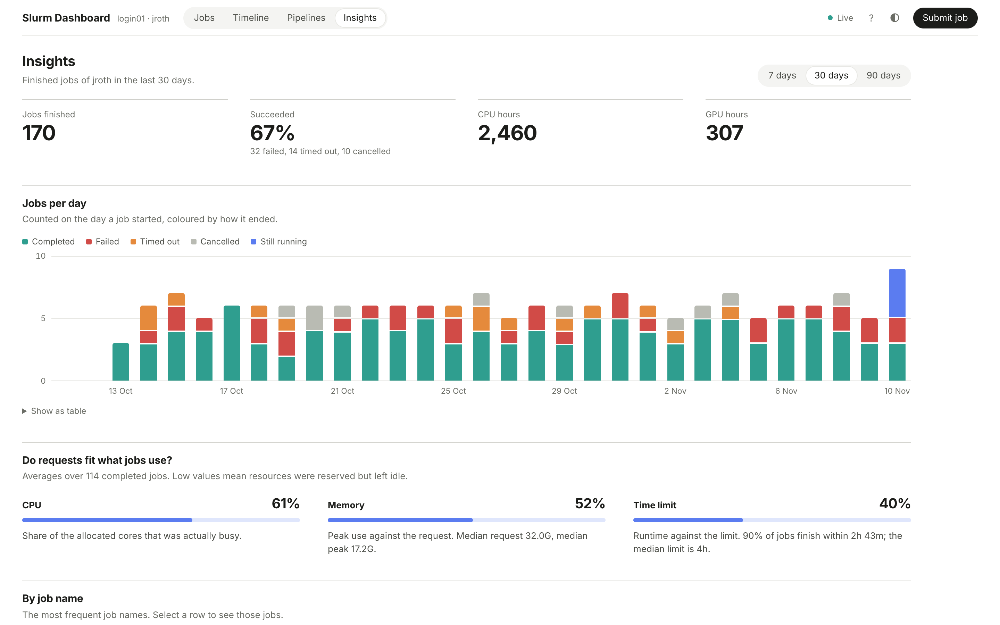
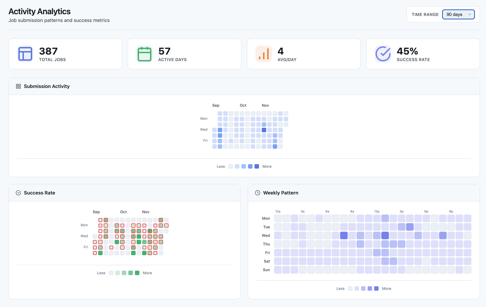

# Slurm Dashboard

[](https://pypi.org/project/slurm-dashboard/)
[](https://pypi.org/project/slurm-dashboard/)

A lightweight, real-time web dashboard for monitoring Slurm HPC cluster jobs. View logs, track resource usage, analyze job patterns, and manage your workloads from a clean, modern interface.



## At a Glance

Slurm Dashboard is a small Flask app and CLI for researchers and ML engineers who run batches of experiments on Slurm clusters. It brings queue state, logs, resource usage, and job history into one browser view so long-running training or analysis jobs are easier to debug.

- Tracks live and historical jobs through Slurm's `squeue` and `sacct` commands
- Streams stdout/stderr from configurable cluster log layouts
- Surfaces failure patterns, resource efficiency, GPU usage, and submission activity
- Ships as a PyPI package with a `slurm-dashboard` command-line entry point

The project is intentionally lightweight: no database, no cluster daemon, and no scheduler-side service. It can run on a login node behind an SSH tunnel and read the same Slurm state a user can already access from the shell.

## Installation

```bash
pip install slurm-dashboard
```

## Features

- **Real-time job monitoring** - Live log streaming with auto-refresh
- **Multiple views** - Table, Timeline, Pipeline DAG, Heatmap, and Insights
- **Job management** - Submit, cancel, and resubmit jobs with templates
- **Submitted scripts** - View the batch script retained by Slurm from each job's `script` button
- **Smart log analysis** - Automatic error detection and highlighting
- **Resource tracking** - CPU/GPU hours, memory efficiency, partition health
- **Analytics dashboard** - Job patterns, peak hours, failure analysis
- **Batch operations** - Select multiple jobs for cancel/resubmit/export
- **Dark mode** - Easy on the eyes during those late-night debugging sessions

## Screenshots

<table>
<tr>
<td width="50%">

**Job List & Logs**



</td>
<td width="50%">

**Insights Dashboard**



</td>
</tr>
<tr>
<td width="50%">

**Heatmap View**



</td>
<td width="50%">

</td>
</tr>
</table>

## Quick Start

```bash
# Basic usage - uses current user and default log location
slurm-dashboard

# Specify log directory
slurm-dashboard --log-root /path/to/your/logs

# Full options
slurm-dashboard --log-root ~/slurm-logs --user myusername --port 8080
```

Then open `http://localhost:5000` in your browser.

## Configuration

### Command Line Options

| Option | Default | Description |
|--------|---------|-------------|
| `--host` | `127.0.0.1` | Host to bind to |
| `--port` | `5000` | Port to bind to |
| `--log-root` | `~/slurm-logs` | Root directory for Slurm log files |
| `--log-pattern` | `{name}/job.{stream}.{id}` | Log file path pattern |
| `--user` | Current user | Slurm username to filter jobs |
| `--refresh-cache` | `20` | Cache refresh interval in seconds |

### Log File Patterns

The dashboard needs to know where your job logs are stored and how they're named. Use `--log-pattern` to match your cluster's configuration.

**Pattern variables:**
- `{name}` - Job name (from `--job-name` or script name)
- `{id}` - Slurm job ID
- `{stream}` - `out` for stdout, `err` for stderr

#### Common Cluster Configurations

**Default Slurm (flat directory):**
```bash
# Logs like: /home/user/slurm-12345.out, slurm-12345.err
slurm-dashboard --log-root ~ --log-pattern "slurm-{id}.{stream}"
```

**Subdirectory per job name (default):**
```bash
# Logs like: ~/slurm-logs/train_model/job.out.12345
slurm-dashboard --log-root ~/slurm-logs --log-pattern "{name}/job.{stream}.{id}"
```

**Nested by job ID:**
```bash
# Logs like: ~/logs/experiment/12345/stdout, ~/logs/experiment/12345/stderr
slurm-dashboard --log-root ~/logs --log-pattern "{name}/{id}/std{stream}"
```

**Project-based structure:**
```bash
# Logs like: /scratch/myproject/logs/job_12345.out
slurm-dashboard --log-root /scratch/myproject/logs --log-pattern "job_{id}.{stream}"
```

**Date-based directories (use wildcards in log-root):**
```bash
# For logs like: ~/logs/2024-01/train_12345.out
# Run from within the date directory or use a symlink
slurm-dashboard --log-root ~/logs/2024-01 --log-pattern "{name}_{id}.{stream}"
```

### Setting Up Your Slurm Scripts

To work with the dashboard, configure your Slurm scripts to write logs to a consistent location:

```bash
#!/bin/bash
#SBATCH --job-name=train_model
#SBATCH --output=/home/%u/slurm-logs/%x/job.out.%j
#SBATCH --error=/home/%u/slurm-logs/%x/job.err.%j

# Your job commands here
python train.py
```

**Slurm filename variables:**
- `%u` - Username
- `%x` - Job name
- `%j` - Job ID
- `%A` - Array job ID
- `%a` - Array task ID

### Array Jobs

For array jobs, you might want to include the array task ID:

```bash
#SBATCH --output=/home/%u/slurm-logs/%x/job.out.%A_%a
#SBATCH --error=/home/%u/slurm-logs/%x/job.err.%A_%a
```

Then use:
```bash
slurm-dashboard --log-pattern "{name}/job.{stream}.{id}"
# The dashboard handles array job IDs like 12345_0, 12345_1 automatically
```

## Running on a Cluster

### SSH Tunnel (Recommended)

If you're running the dashboard on a login node:

```bash
# On the cluster
slurm-dashboard --port 5000

# On your local machine (in another terminal)
ssh -L 5000:localhost:5000 user@cluster.example.com

# Then open http://localhost:5000 in your browser
```

### Binding to All Interfaces

To access from other machines on the same network (less secure):

```bash
slurm-dashboard --host 0.0.0.0 --port 5000
```

**Note:** Only do this on trusted networks. The dashboard can cancel and submit jobs.

### Running in Background

```bash
# Using nohup
nohup slurm-dashboard --log-root ~/slurm-logs > dashboard.log 2>&1 &

# Using screen
screen -S dashboard
slurm-dashboard --log-root ~/slurm-logs
# Ctrl+A, D to detach

# Using tmux
tmux new -s dashboard
slurm-dashboard --log-root ~/slurm-logs
# Ctrl+B, D to detach
```

### Restarting a Remote Dashboard

`scripts/restart-remote-dashboard.sh` restarts a dashboard that runs in a
tmux session on a cluster host, and waits until it answers HTTP requests. Run
it from your workstation:

```bash
# Restart only
scripts/restart-remote-dashboard.sh

# Install a git ref, then restart
git fetch origin
scripts/restart-remote-dashboard.sh --ref origin/main
```

With `--ref`, the script builds a wheel locally from that commit, copies it
to the host and installs it offline with `--no-deps`. The cluster does not
need GitHub access. The script records the deployed commit in the
virtualenv and prints the previous one, so you can roll back with
`--ref <previous commit>`.

The defaults match the `agent_3d` deployment: host `agent_3d`, virtualenv
`~/LiteReality-Agent/.venv`, tmux session `ttsd-slurm-dashboard`, port 8787.
Override them with options or `SLURMBOARD_*` environment variables; see
`--help`. The script refuses to start if the port is in use outside the tmux
session. It never submits, cancels or modifies Slurm jobs.

## Views

### Table View (Default)
- Running jobs with real-time status
- Recent jobs with expandable details
- Click any job to view its logs
- Quick filters for state, partition, GPU usage

### Timeline View
- Gantt-style visualization of job history
- See job overlaps and gaps
- Filter by state or job name
- Zoom in/out for different time scales

### Pipeline View
- DAG visualization of job dependencies
- Track pipeline progress
- See which jobs are blocking others

### Heatmap View
- GitHub-style activity calendar
- Hourly submission patterns
- Success/failure rate visualization

### Insights View
- Efficiency score (A-F grade)
- Resource usage metrics (CPU/GPU hours)
- Memory and time limit recommendations
- Failure pattern detection
- Peak hours analysis
- Top job types

## Troubleshooting

### Reading long recent-job names

Expand a recent job by clicking its name or chevron to read the full name.
Expanded names wrap, including names without spaces on narrow screens, and are
visible while details load or if loading fails. Collapsed rows stay compact.

### Viewing submitted batch scripts

Use **script** next to a running or recent job's log buttons, or **View submitted
script** in the job details modal. This reads the copy submitted to Slurm, not
the current file named in the submission command. Changing or deleting that
source file does not change Slurm's retained copy. The viewer does not submit,
cancel, or modify jobs, and leaves log streams running.

The dashboard first sends `write batch_script JOB_ID -` to the `scontrol`
interactive command reader. Slurm documents this command for interactive use;
the dashboard pipes it to `scontrol --quiet` and reads the controller's retained
copy from stdout without writing a file. It then tries
`sacct --batch-script -j JOB_ID --noheader` as a fallback.
Historical retrieval requires a supported Slurm version and
`AccountingStoreFlags=job_script` to have been enabled when the job ran; the
dashboard does not enable it. Access uses the dashboard process's Slurm identity;
the controller permits only the job owner or a privileged user. Slurm permission
denials, unavailable scripts, unsupported clients, and retrieval errors are
shown explicitly. There is no fallback to a possibly changed source file.

The preview is limited to 200 lines or 1 MiB and labels truncation. It includes
the submitted script (including generated `sbatch --wrap` scripts), but not
command-line resource overrides, the submission environment, or the contents of
files referenced by the script. Jobs submitted without batch scripts have no
script to display. Individual numeric array task IDs are accepted; grouped array
ranges are not. Keep the dashboard behind a trusted SSH tunnel: scripts can
contain sensitive values.

### "No recent logs found"
- Check that `--log-root` points to the correct directory
- Verify `--log-pattern` matches your log file naming
- Ensure log files exist and are readable

### "sacct: command not found"
- The dashboard requires Slurm commands to be in your PATH
- Make sure you're running on a node with Slurm client tools installed

### Jobs not showing up
- Check that `--user` matches the username used when submitting jobs
- Verify jobs are in sacct history: `sacct -u $USER --starttime=now-7days`

### Log streaming not working
- Ensure the log files are accessible from the node running the dashboard
- Check file permissions on the log directory

## Development

```bash
# Install in development mode
pip install -e ".[dev]"

# Run with debug mode
FLASK_DEBUG=1 slurm-dashboard

# Run tests
pytest

# Run frontend regression tests (requires Node.js 18+; no npm dependencies)
node --test tests/dashboard_*.test.cjs
```

## License

MIT
