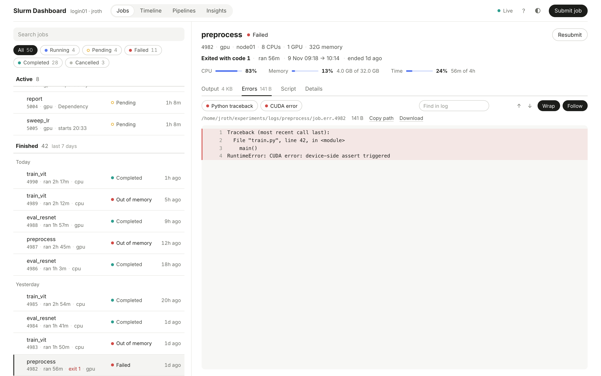
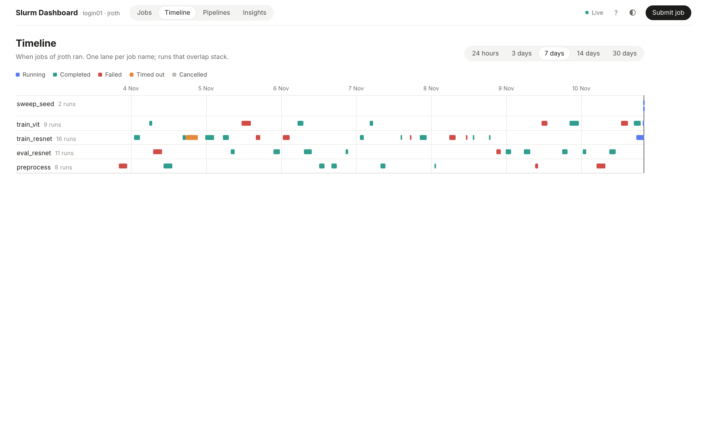
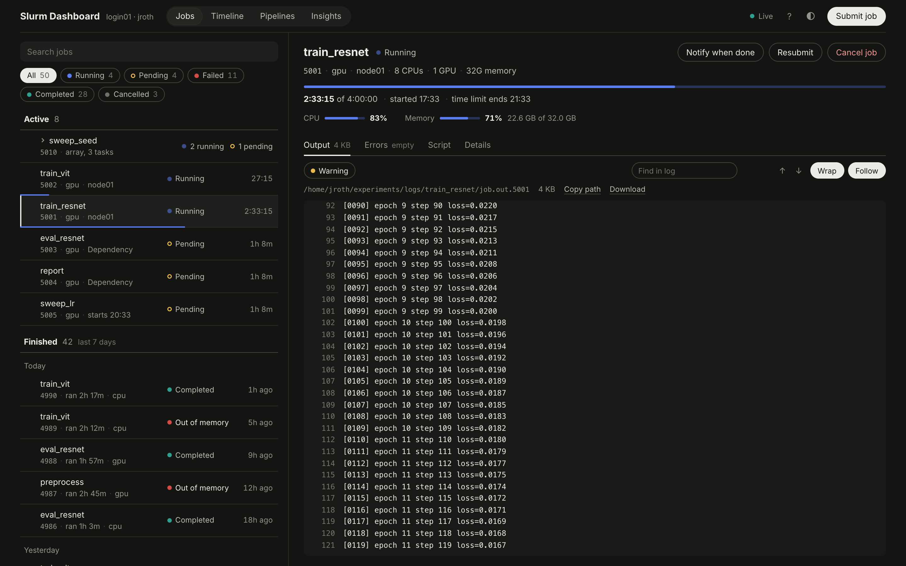

# Slurm Dashboard

[](https://pypi.org/project/slurm-dashboard/)
[](https://pypi.org/project/slurm-dashboard/)

A lightweight web app for monitoring and managing your Slurm jobs: live queue, job history, log streaming, submit / cancel / resubmit, and usage analytics.


## At a Glance

Slurm Dashboard is a small Flask app and CLI for researchers and ML engineers who run batches of experiments on Slurm clusters. It brings queue state, logs, resource usage, and job history into one browser view so long-running training or analysis jobs are easier to debug.

- Reads jobs straight from Slurm (`squeue`, `sacct`), so every job shows up, with or without log files
- Finds and streams stdout/stderr using the paths Slurm recorded, with a configurable pattern as fallback
- Submits, cancels and resubmits jobs; saves reusable job templates
- Shows CPU / memory / time-limit efficiency, failure patterns and CPU/GPU hours
- Protected by an access token, because login nodes are shared

The project is intentionally lightweight: no database, no cluster daemon, and no scheduler-side service. It runs on a login node behind an SSH tunnel and reads the same Slurm state you can already access from the shell. One `squeue` and one `sacct` result are cached and shared by all views and browser tabs, so it stays gentle on the scheduler.

## Installation

```bash
pip install slurm-dashboard
```

## Features

- **One list for everything** - running, pending and finished jobs, grouped by day, with array tasks folded into one row per array
- **A page per job** - state, runtime against the time limit, why a pending job is waiting (in plain words), efficiency, and tabs for output, errors, script and details
- **Log viewer** - follows live output, handles progress bars and colour codes, flags tracebacks, out-of-memory kills and other problems, searches, and can load or download the whole file
- **Job management** - submit a pasted script or a file, cancel, resubmit with changed resources, act on many jobs at once, reusable templates
- **Search** - plain words, or filters such as `partition:gpu`, `state:timeout`, `name:train*`, `exit:!0`; the address bar keeps the current view, so it can be bookmarked
- **Timeline, Pipelines, Insights** - when jobs ran, dependency chains as graphs, and how well resource requests match actual use
- **Keyboard driven** - press `?` in the app for the shortcuts
- **All-users mode** - `--all-users` shows the whole cluster, read-only for jobs that are not yours
- **Clear failures** - if a Slurm command fails or times out, the page says so and keeps the last data
- **Light and dark**, and usable on a phone

## Screenshots

A failed job opens on its error output, with the traceback marked:



Insights: outcomes per day and how well requests fit:


Timeline: one lane per job name:



Dark theme:



## Quick Start

```bash
slurm-dashboard
```

The command prints a link such as `http://127.0.0.1:5000/?token=...`. Open it once; the browser then remembers the token in a cookie.

```bash
# More options
slurm-dashboard --port 8080 --history-days 14 --log-root /path/to/your/logs
```

## Security

The dashboard can submit and cancel jobs as you, and on a login node any other user can connect to a port bound to `127.0.0.1`. Every request therefore needs an access token.

- The token is generated on first start and stored in `~/.config/slurm-dashboard/token` (readable only by you), so bookmarks keep working across restarts. Delete the file to rotate it.
- `--token VALUE` or the `SLURM_DASHBOARD_TOKEN` environment variable set your own token.
- API clients can send `Authorization: Bearer <token>`.
- `--no-auth` turns the check off. Only use it on a machine nobody else can log in to.
- Scripts and logs are always looked up by job ID from Slurm's own records; the browser cannot ask the server to read an arbitrary path.
- Traffic is plain HTTP. Use an SSH tunnel rather than `--host 0.0.0.0`.

## Configuration

### Command Line Options

| Option | Default | Description |
|--------|---------|-------------|
| `--host` | `127.0.0.1` | Host to bind to |
| `--port` | `5000` | Port to bind to |
| `--user` | Current user | Whose jobs to show |
| `--all-users` | off | Show every user's jobs (you can still only change your own) |
| `--history-days` | `7` | Days of finished jobs listed by default (max 90; the list can go back further on request) |
| `--log-root` | `~/slurm-logs` | Fallback directory to search for log files |
| `--log-pattern` | `{name}/job.{stream}.{id}` | Fallback log file pattern under `--log-root` |
| `--refresh-cache` | `20` | Seconds to reuse accounting results and the log index |
| `--token` | generated | Access token to require |
| `--no-auth` | off | Disable the access token |
| `-v`, `--verbose` | off | Log every Slurm command and HTTP request |

### How Logs Are Found

For each job the dashboard tries, in order:

1. The output path the scheduler reports for running and pending jobs (`scontrol show job`).
2. The output pattern stored in accounting (`sacct` fields `StdOut`/`StdErr`, available in recent Slurm versions), with `%j`, `%A`, `%a`, `%x`, `%u` and `%N` expanded.
3. A file under `--log-root` that matches `--log-pattern`.
4. Slurm's default `slurm-<jobid>.out` in the job's working directory.

On a recent Slurm version this needs no configuration. On older versions, or for jobs that have aged out of accounting, set `--log-root` and `--log-pattern`. If no file is found, the log panel lists every path it tried.

### Log File Patterns

The dashboard needs to know where your job logs are stored and how they're named. Use `--log-pattern` to match your cluster's configuration.

**Pattern variables:**
- `{name}` - Job name (from `--job-name` or script name)
- `{id}` - Slurm job ID
- `{stream}` - `out` for stdout, `err` for stderr

#### Common Cluster Configurations

**Default Slurm (flat directory):**
```bash
# Logs like: /home/user/slurm-12345.out, slurm-12345.err
slurm-dashboard --log-root ~ --log-pattern "slurm-{id}.{stream}"
```

**Subdirectory per job name (default):**
```bash
# Logs like: ~/slurm-logs/train_model/job.out.12345
slurm-dashboard --log-root ~/slurm-logs --log-pattern "{name}/job.{stream}.{id}"
```

**Nested by job ID:**
```bash
# Logs like: ~/logs/experiment/12345/stdout, ~/logs/experiment/12345/stderr
slurm-dashboard --log-root ~/logs --log-pattern "{name}/{id}/std{stream}"
```

**Project-based structure:**
```bash
# Logs like: /scratch/myproject/logs/job_12345.out
slurm-dashboard --log-root /scratch/myproject/logs --log-pattern "job_{id}.{stream}"
```

**Date-based directories (use wildcards in log-root):**
```bash
# For logs like: ~/logs/2024-01/train_12345.out
# Run from within the date directory or use a symlink
slurm-dashboard --log-root ~/logs/2024-01 --log-pattern "{name}_{id}.{stream}"
```

### Setting Up Your Slurm Scripts

To work with the dashboard, configure your Slurm scripts to write logs to a consistent location:

```bash
#!/bin/bash
#SBATCH --job-name=train_model
#SBATCH --output=/home/%u/slurm-logs/%x/job.out.%j
#SBATCH --error=/home/%u/slurm-logs/%x/job.err.%j

# Your job commands here
python train.py
```

**Slurm filename variables:**
- `%u` - Username
- `%x` - Job name
- `%j` - Job ID
- `%A` - Array job ID
- `%a` - Array task ID

### Array Jobs

For array jobs, you might want to include the array task ID:

```bash
#SBATCH --output=/home/%u/slurm-logs/%x/job.out.%A_%a
#SBATCH --error=/home/%u/slurm-logs/%x/job.err.%A_%a
```

Then use:
```bash
slurm-dashboard --log-pattern "{name}/job.{stream}.{id}"
# The dashboard handles array job IDs like 12345_0, 12345_1 automatically
```

## Running on a Cluster

### SSH Tunnel (Recommended)

If you're running the dashboard on a login node:

```bash
# On the cluster
slurm-dashboard --port 5000

# On your local machine (in another terminal)
ssh -L 5000:localhost:5000 user@cluster.example.com

# Then open the printed link (http://127.0.0.1:5000/?token=...) in your browser
```

### Binding to All Interfaces

```bash
slurm-dashboard --host 0.0.0.0 --port 5000
```

The access token is still required, but traffic is unencrypted, so anyone on the network path can read it. Prefer the SSH tunnel.

### Running in Background

```bash
# Using nohup
nohup slurm-dashboard --log-root ~/slurm-logs > dashboard.log 2>&1 &

# Using screen
screen -S dashboard
slurm-dashboard --log-root ~/slurm-logs
# Ctrl+A, D to detach

# Using tmux
tmux new -s dashboard
slurm-dashboard --log-root ~/slurm-logs
# Ctrl+B, D to detach
```

## Views

### Jobs
- **Active** lists running and pending jobs; **Finished** lists the last `--history-days` days, with a link at the bottom to go back 30 or 90 days.
- Select a job to open its page on the right. The log tabs follow new output; scroll up to pause, press `f` to follow again.
- Tick jobs (shift-click for a range, or tick an array) to cancel, resubmit or export several at once.
- The chips filter by state. The search box takes plain words or `field:value` filters; `?` lists them.

### Timeline
- One lane per job name over the last 1 to 30 days, coloured by outcome. Runs that overlap stack.
- Select a bar to open that job.

### Pipelines
- Jobs linked with `--dependency`, drawn as a graph, with progress per chain.

### Insights
- Jobs per day by outcome, with the numbers available as a table.
- CPU, memory and time-limit efficiency of completed jobs, with a suggestion when requests are far above actual use.
- Runs, success rate, typical runtime and CPU/GPU hours per job name and per partition. Select a row to see those jobs.

## Troubleshooting

### A yellow banner says a Slurm command failed
The message quotes the failing command (`squeue`, `sacct`, ...). Run it in a shell on the same node to see the full error. The page keeps showing the last data that loaded.

### "Not signed in"
Open the link with `?token=...` that the dashboard printed at startup, or copy the token from `~/.config/slurm-dashboard/token`.

### "No stdout file found"
The log panel lists the paths it tried. If your logs live elsewhere, set `--log-root` and `--log-pattern`.

### Finished jobs are missing
- The list covers `--history-days` (default 7); use the link at the bottom of the list to go back further. Check `sacct -u $USER --starttime=now-7days`.
- With `--user`, make sure the name matches the submitting user.

### Efficiency shows N/A
Memory efficiency needs job accounting with memory tracking (`JobAcctGatherType`) on the cluster; CPU efficiency needs a job that has finished at least one step.

## Development

```bash
pip install -e ".[dev]"
pytest
```

The tests run against a small fake Slurm CLI in `tests/fake_slurm/`. The same fake lets you run the dashboard on a laptop without a cluster:

```bash
python tests/fake_slurm/demo.py /tmp/demo-cluster
PATH="$PWD/tests/fake_slurm:$PATH" FAKE_SLURM_STATE=/tmp/demo-cluster/state.json slurm-dashboard --log-root /tmp/demo-cluster/logs --all-users
```

See [CHANGELOG.md](CHANGELOG.md) for what changed between versions.

## License

MIT
